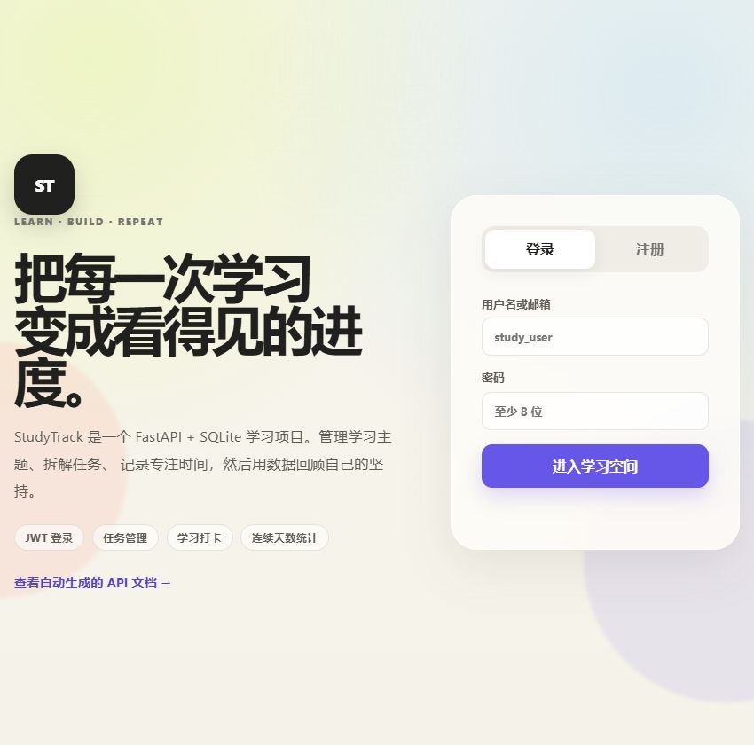
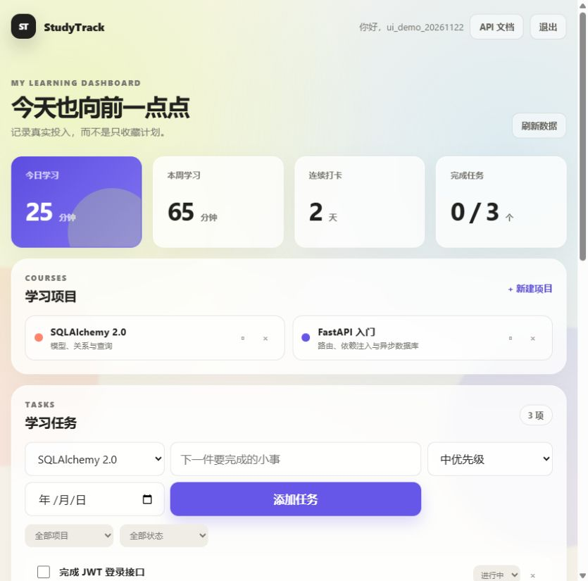
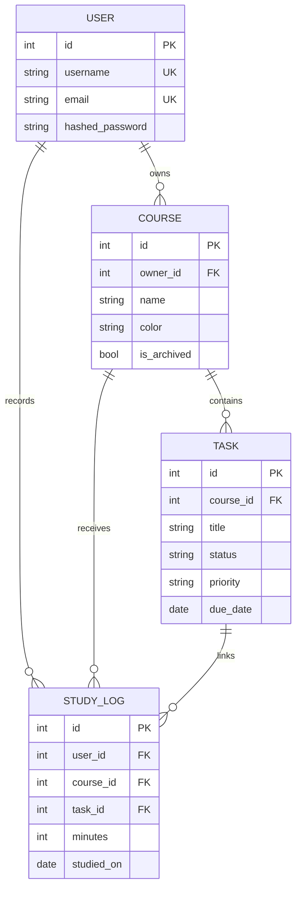

# StudyTrack · 学习任务与打卡系统

一个中等规模、适合逐文件手敲学习的 **FastAPI + SQLite** 全栈练习项目。

它不只是 CRUD：包含 JWT 登录、用户数据隔离、分页筛选、学习时长统计、连续打卡计算、级联删除、异步数据库访问、自动化测试，以及一个无需前端构建工具的轻量网页。

## 界面预览

| 登录页 | 学习仪表盘 |
| --- | --- |
|  |  |

## 功能

- 用户注册、登录、JWT 身份认证
- 每个用户只能访问自己的学习项目、任务和学习记录
- 学习项目 CRUD、归档与删除
- 学习任务 CRUD，支持状态、优先级、截止日期、搜索和分页
- 学习打卡记录，可关联具体任务
- 学习统计：今日、本周、累计时长、连续打卡天数、14 天趋势
- 按项目统计时长和任务完成率
- Swagger 自动接口文档：`/docs`
- 原生 HTML / CSS / JavaScript 管理界面
- Pytest 接口测试与 Ruff 静态检查

## 技术栈

| 层次 | 技术 |
| --- | --- |
| Web 框架 | FastAPI |
| 数据校验 | Pydantic v2 |
| ORM | SQLAlchemy 2.x |
| 数据库 | SQLite + aiosqlite |
| 认证 | PyJWT + OAuth2 Password Flow |
| 密码哈希 | Argon2（pwdlib） |
| 测试 | Pytest + HTTPX |
| 前端 | 原生 HTML / CSS / JavaScript |

## 快速开始

推荐使用 [uv](https://docs.astral.sh/uv/)：

```powershell
uv sync --extra dev
Copy-Item .env.example .env
uv run uvicorn app.main:app --reload
```

然后打开：

- 管理界面：<http://127.0.0.1:8000>
- API 文档：<http://127.0.0.1:8000/docs>
- 健康检查：<http://127.0.0.1:8000/health>

首次启动会自动创建 `study_tracker.db`。在网页注册账号后即可创建学习项目、添加任务并打卡。

### 使用 pip 的等价方式

```powershell
python -m venv .venv
.\.venv\Scripts\Activate.ps1
python -m pip install -r requirements.txt
python -m pip install pytest pytest-asyncio httpx ruff
uvicorn app.main:app --reload
```

## 推荐体验流程

1. 注册账号并登录。
2. 新建一个学习项目，例如“FastAPI 入门”。
3. 添加任务，例如“理解依赖注入”。
4. 学习后在右侧记录 30 分钟。
5. 把任务标记为完成，观察统计和项目进度变化。
6. 打开 `/docs`，在 Swagger 中直接调用接口。

## 项目结构

```text
.
├── app/
│   ├── api/
│   │   ├── deps.py              # 获取当前登录用户等依赖
│   │   ├── router.py            # 汇总所有 API 路由
│   │   └── routes/
│   │       ├── auth.py          # 注册、登录、当前用户
│   │       ├── courses.py       # 学习项目接口
│   │       ├── tasks.py         # 学习任务接口
│   │       ├── study_logs.py    # 学习记录接口
│   │       └── stats.py         # 学习统计接口
│   ├── core/
│   │   ├── config.py            # 环境变量配置
│   │   ├── exceptions.py        # 业务异常
│   │   └── security.py          # 密码哈希与 JWT
│   ├── db/
│   │   ├── base.py              # SQLAlchemy Base
│   │   ├── init_db.py           # 本地自动建表
│   │   └── session.py           # 异步引擎与 Session 依赖
│   ├── models/                  # SQLAlchemy 数据模型
│   ├── schemas/                 # Pydantic 请求/响应模型
│   ├── services/                # 业务逻辑
│   ├── static/                  # 网页界面
│   └── main.py                  # 应用入口
├── docs/
│   ├── LEARNING_GUIDE.md        # 手敲与学习路线
│   └── studytrack.http          # PyCharm/IDEA HTTP 请求示例
├── tests/                       # 接口测试
├── .env.example
├── pyproject.toml
└── requirements.txt
```

## 数据模型



## API 一览

所有业务接口均位于 `/api/v1`，除注册和登录外都需要 Bearer Token。

| 方法 | 路径 | 说明 |
| --- | --- | --- |
| POST | `/auth/register` | 注册 |
| POST | `/auth/login` | 登录并获取 JWT |
| GET | `/auth/me` | 当前用户 |
| GET | `/courses` | 项目列表 |
| POST | `/courses` | 创建项目 |
| GET | `/courses/{id}` | 项目详情 |
| PATCH | `/courses/{id}` | 更新或归档项目 |
| DELETE | `/courses/{id}` | 删除项目 |
| GET | `/tasks` | 任务列表、筛选、分页 |
| POST | `/tasks` | 创建任务 |
| GET | `/tasks/{id}` | 任务详情 |
| PATCH | `/tasks/{id}` | 更新任务 |
| DELETE | `/tasks/{id}` | 删除任务 |
| GET | `/study-logs` | 学习记录列表 |
| POST | `/study-logs` | 新增打卡 |
| DELETE | `/study-logs/{id}` | 删除打卡 |
| GET | `/stats/overview` | 总览统计与趋势 |
| GET | `/stats/courses` | 分项目统计 |

## PowerShell API 示例

注册：

```powershell
$register = @{
    username = "demo_user"
    email = "demo@example.com"
    password = "password123"
} | ConvertTo-Json

Invoke-RestMethod `
    -Method Post `
    -Uri "http://127.0.0.1:8000/api/v1/auth/register" `
    -ContentType "application/json" `
    -Body $register
```

登录并保存 Token：

```powershell
$login = Invoke-RestMethod `
    -Method Post `
    -Uri "http://127.0.0.1:8000/api/v1/auth/login" `
    -ContentType "application/x-www-form-urlencoded" `
    -Body @{ username = "demo_user"; password = "password123" }

$headers = @{ Authorization = "Bearer $($login.access_token)" }
```

创建项目和任务：

```powershell
$course = Invoke-RestMethod `
    -Method Post `
    -Uri "http://127.0.0.1:8000/api/v1/courses" `
    -Headers $headers `
    -ContentType "application/json" `
    -Body (@{ name = "FastAPI 入门"; color = "#6657e8" } | ConvertTo-Json)

$task = Invoke-RestMethod `
    -Method Post `
    -Uri "http://127.0.0.1:8000/api/v1/tasks" `
    -Headers $headers `
    -ContentType "application/json" `
    -Body (@{
        course_id = $course.id
        title = "理解依赖注入"
        priority = "high"
    } | ConvertTo-Json)
```

更多请求示例见 `docs/studytrack.http`，可直接在 PyCharm 中运行。

## 测试与检查

```powershell
uv run pytest -q
uv run ruff check app tests
```

当前测试覆盖：

- 注册、登录、错误密码、未登录访问
- 用户数据隔离
- 项目 CRUD、归档和过滤
- 任务 CRUD、筛选、状态流转和校验
- 学习记录、跨项目任务校验
- 统计计算和项目统计
- 删除项目后的级联清理

## 配置说明

配置来自 `.env`：

| 变量 | 默认值 | 说明 |
| --- | --- | --- |
| `SECRET_KEY` | 开发用默认值 | JWT 签名密钥，生产环境必须修改 |
| `ACCESS_TOKEN_EXPIRE_MINUTES` | `10080` | Token 有效期，默认 7 天 |
| `DATABASE_URL` | `sqlite+aiosqlite:///./study_tracker.db` | 数据库连接 |
| `AUTO_CREATE_TABLES` | `true` | 启动时自动建表 |
| `SQL_ECHO` | `false` | 是否打印 SQL |
| `CORS_ORIGINS` | 本地地址 | 允许跨域的前端地址 |

> 当前 `AUTO_CREATE_TABLES=true` 是为了降低学习门槛。真正上线时应关闭自动建表，改用 Alembic 管理数据库迁移，并更换强随机的 `SECRET_KEY`。

## 建议的后续扩展

- 引入 Alembic 数据库迁移
- 增加刷新 Token 与权限角色
- 增加标签、子任务和任务排序
- 增加周报和月度热力图
- 使用 Docker 部署
- 将网页改造成 React / Vue 项目
- 增加 Redis 缓存与限流

如果是第一次手敲，请从 `docs/LEARNING_GUIDE.md` 中的阶段路线开始，不要一次性复制所有文件。